# ☕ Palm Café POS · كافيه النخيل

**A bilingual (Arabic / English) point-of-sale app for cafés, built with Swift & SwiftUI for Mac and iPad — with cashier control and audit built in.**

**نظام كاشير لكافيه بالعربي والإنجليزي، مبني بـ Swift و SwiftUI لأجهزة Mac و iPad، ومعمول من الأساس عشان صاحب المحل يقدر يراقب الكاش والكاشيرات.**
  

### 🇪🇬 الواجهة العربي · Arabic interface
| تسجيل الدخول | البيع | تقفيل الشيفت |
| --- | --- | --- |
| 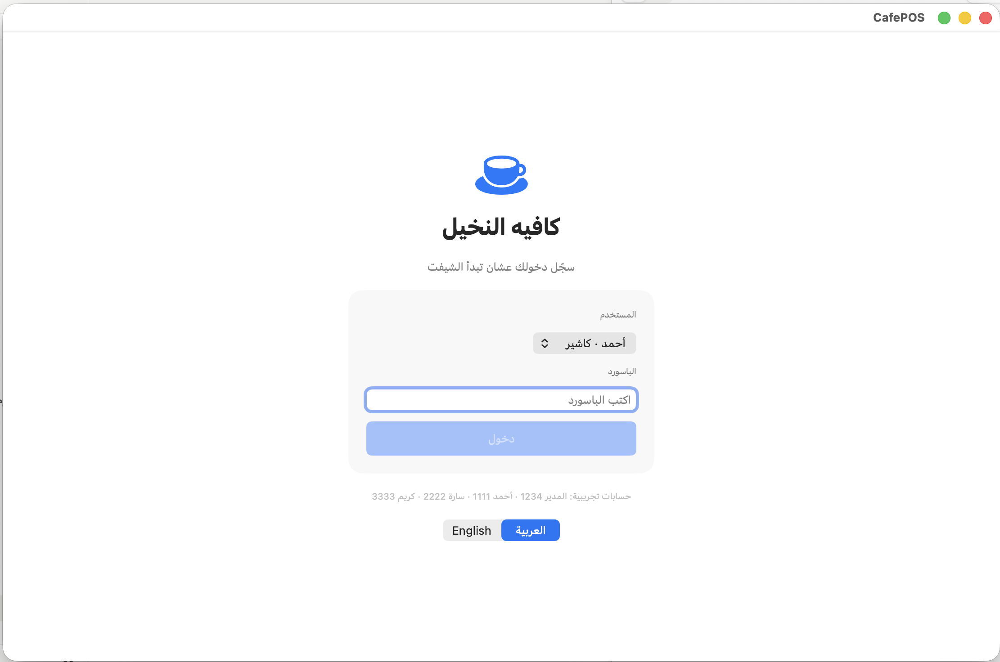 | 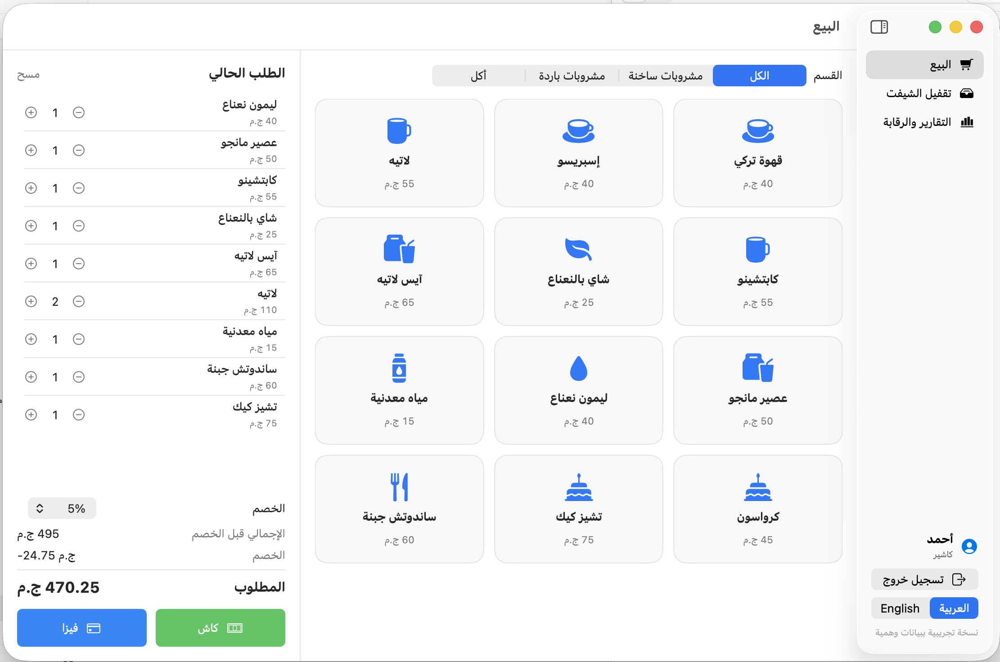 | 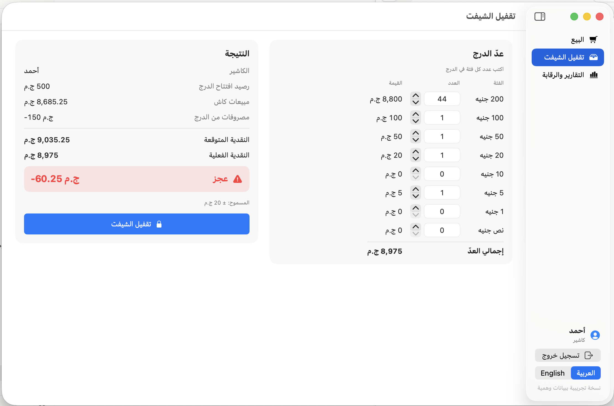 |

| التقارير | سجل الرقابة | المنيو |
| --- | --- | --- |
| 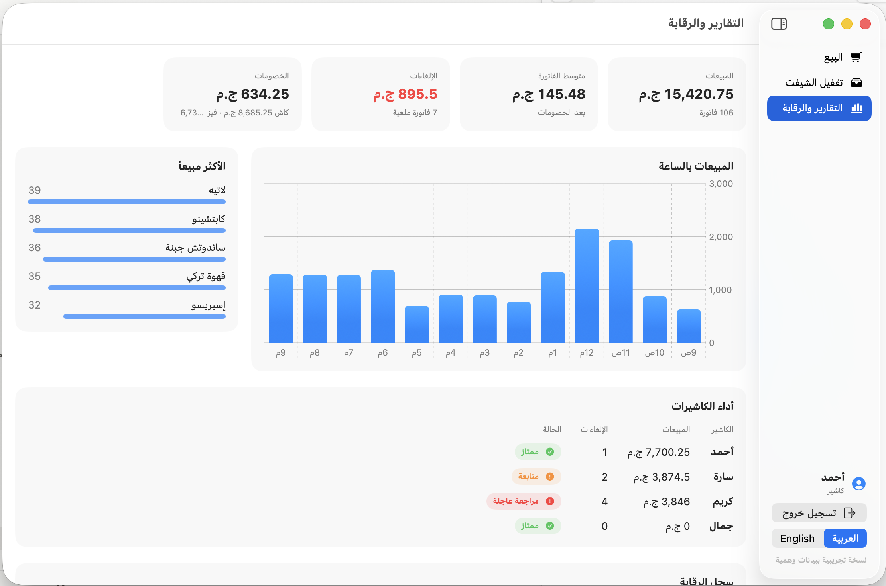 | 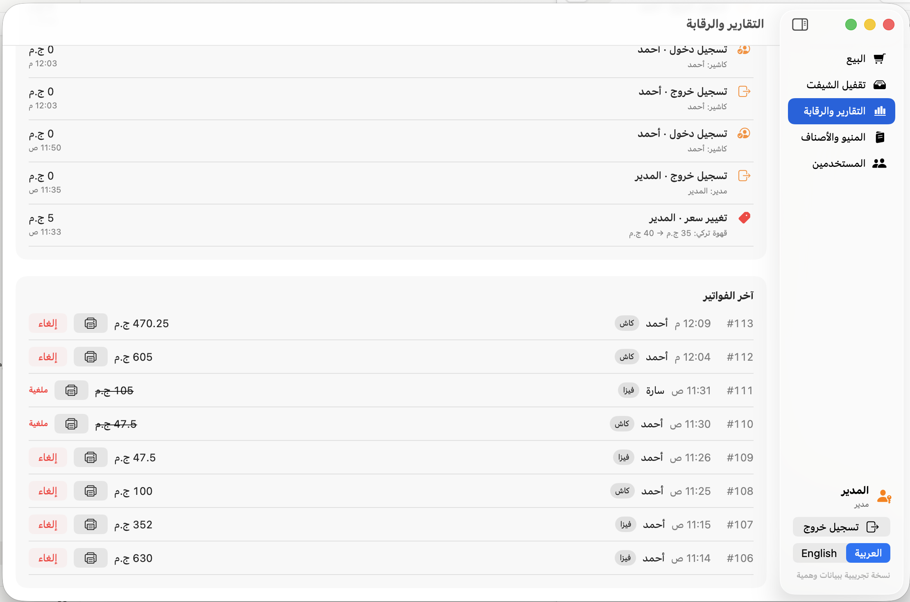 | 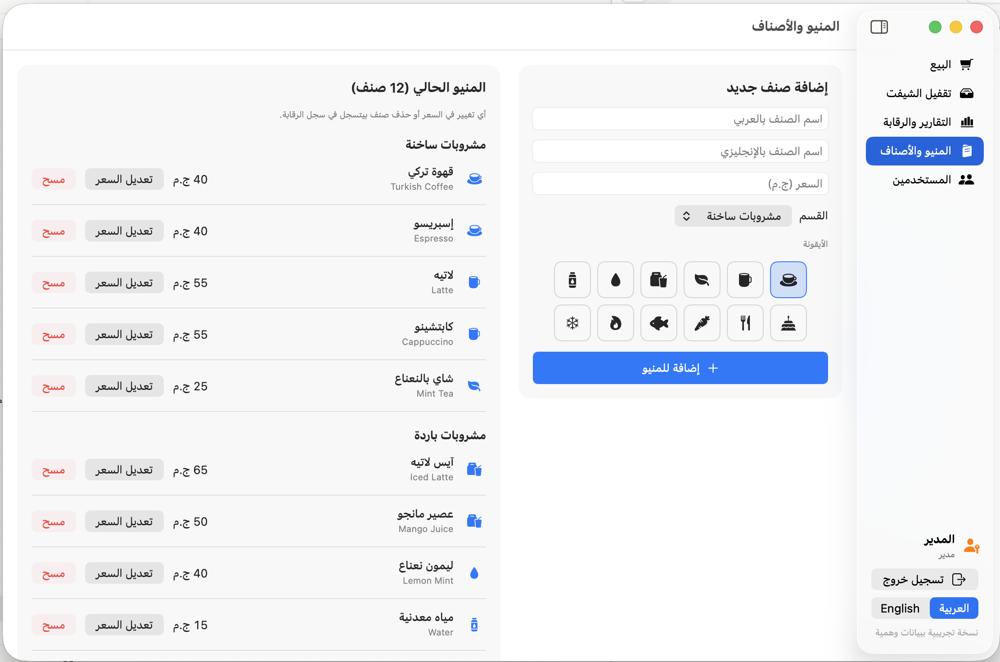 |

| موافقة المدير على الخصم | إلغاء فاتورة | الفاتورة المطبوعة |
| --- | --- | --- |
| 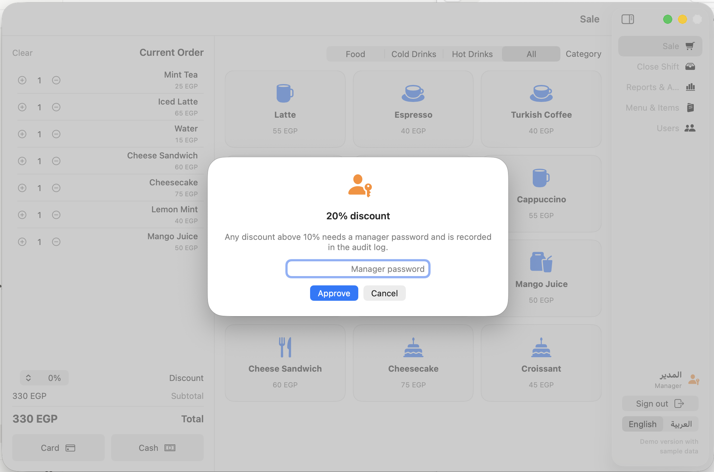 | 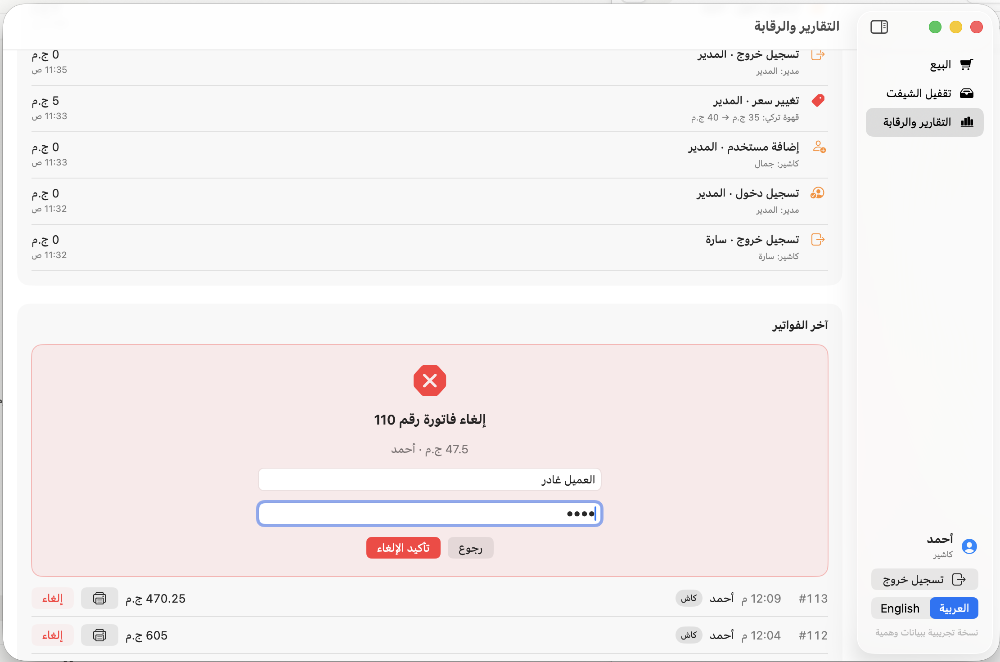 | 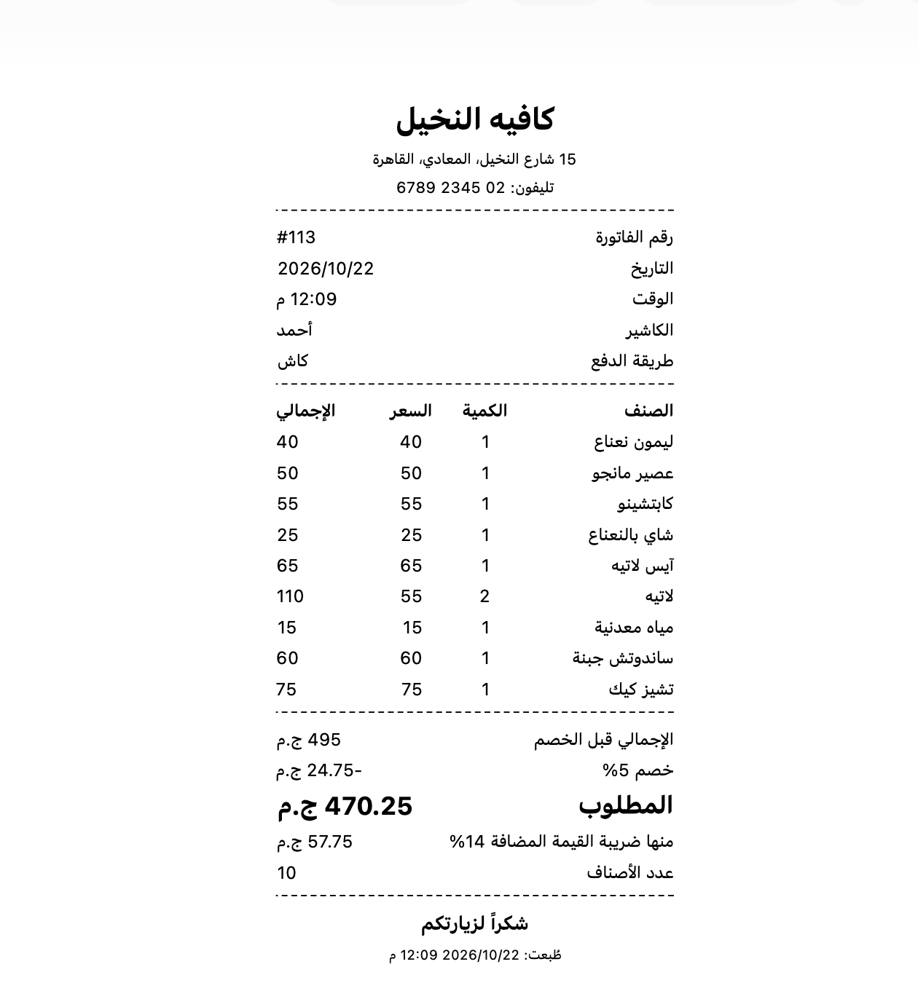 |

### 🇬🇧 English interface
| Login | Sale | Reports |
| --- | --- | --- |
| 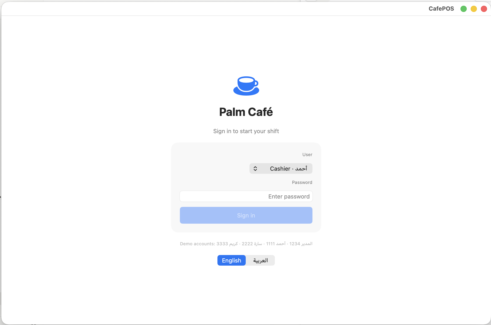 | 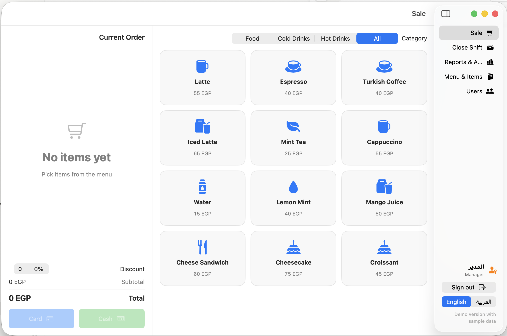 | 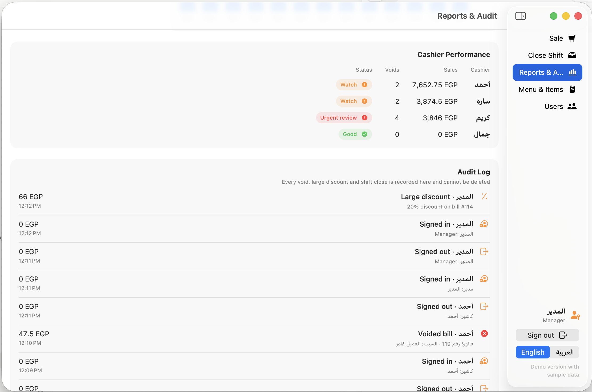 |

| Menu | Manage items & users | Printed bill |
| --- | --- | --- |
| 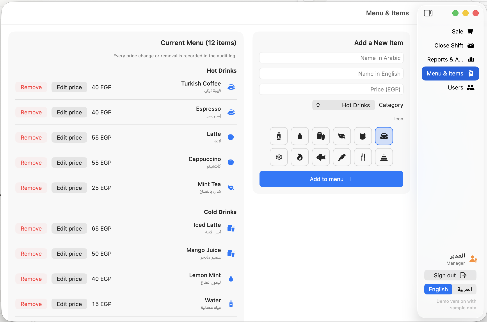 | 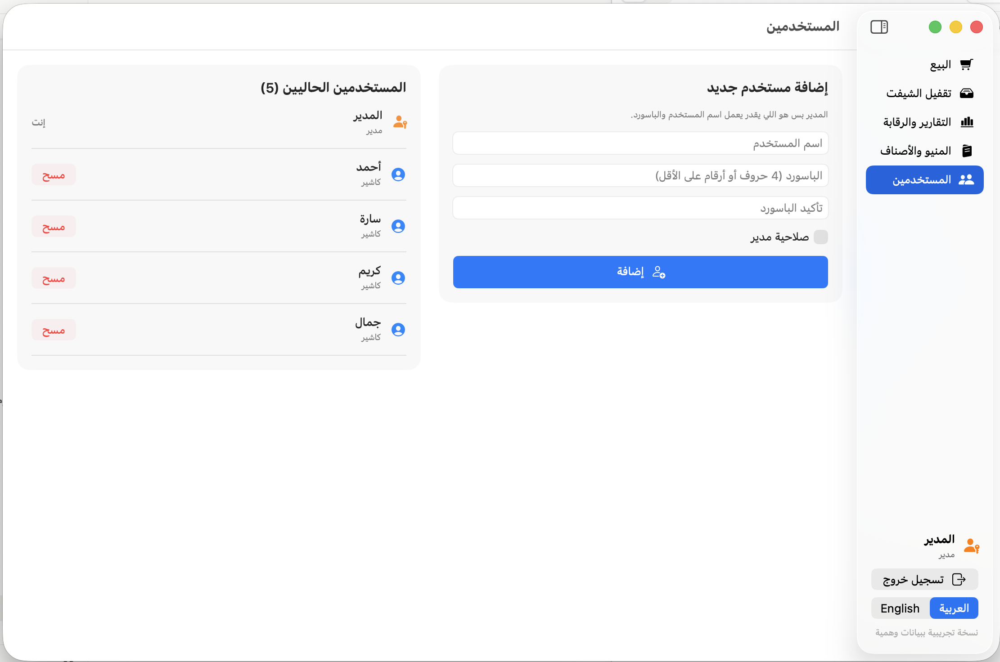 | 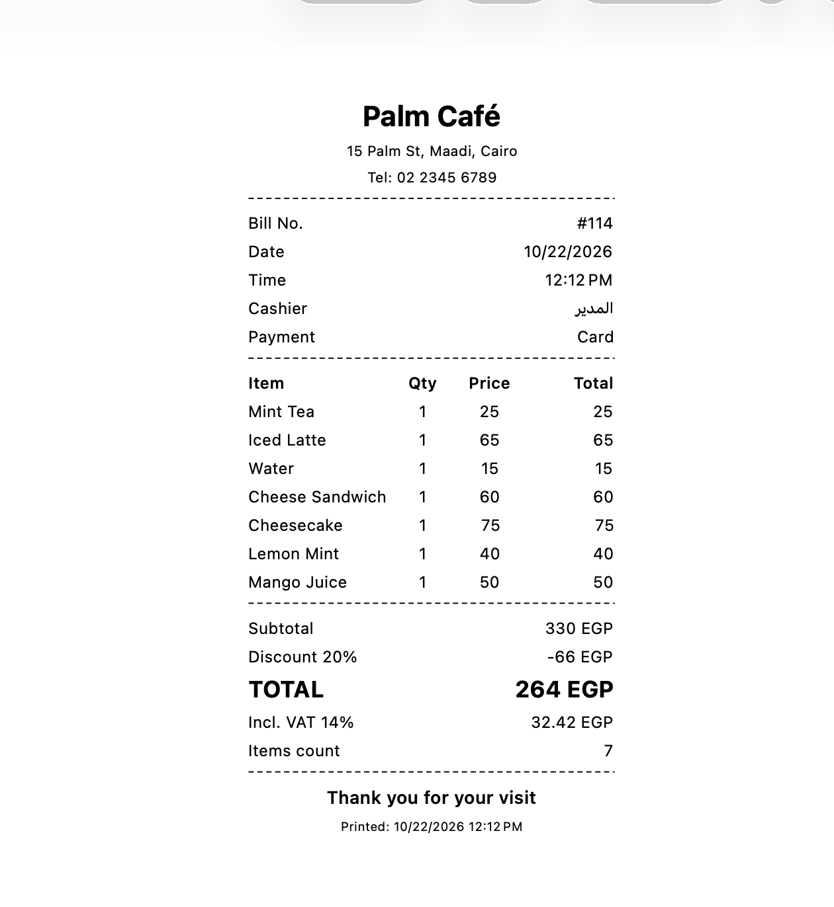 |

---

## 🇬🇧 English

### Why this app
Small café and restaurant owners often lose money at the cash drawer without knowing how: voided bills, unapproved discounts, reprinted receipts and unexplained shortages. This app is designed around that problem. Every sensitive action needs a manager and is written to an audit log that cannot be edited.

### Features
- **Sale screen** – menu by category, quantities, cash or card payment, instant bill.
- **User accounts** – each cashier signs in with their own name and password. Only a manager can create or remove users.
- **Manager approvals** – discounts above a set limit and bill voids require a manager password and a reason.
- **Audit log** – sign-ins, voids, large discounts, price changes, reprints and shift closes are recorded and cannot be deleted.
- **Shift close** – count the drawer by denomination; the app compares expected and counted cash and flags *Balanced / Short / Over*.
- **Reports** – sales by hour, top sellers, voids, discounts and a per-cashier status (*Good / Watch / Urgent review*).
- **Menu management** – the manager adds items (Arabic and English names), changes prices and removes items.
- **Printed bill** – 80 mm receipt layout with shop details, items, discount, VAT and totals. Reprints are marked **COPY** and logged.
- **Arabic and English** – full right-to-left support, switchable from the app.
- **Secure passwords** – stored as SHA-256 hashes, never as plain text.

### Demo accounts
| User | Password | Role |
| --- | --- | --- |
| المدير | 1234 | Manager |
| أحمد | 1111 | Cashier |
| سارة | 2222 | Cashier |
| كريم | 3333 | Cashier |

> The app ships with one day of **sample data** so the reports and audit log can be explored straight away. The sample cashier "كريم" is deliberately set up with frequent voids and discounts to show how the reports flag a problem.

### Tech stack
Swift · SwiftUI · Swift Charts · Observation (`@Observable`) · CryptoKit · PDFKit / ImageRenderer for printing · UserDefaults for local storage.

### Run it
1. Open the project in **Xcode 15 or later**.
2. Choose **My Mac** (or an iPad simulator) and press **Run** (⌘R).
3. On macOS, enable **App Sandbox → Hardware → Printing** and **File Access → User Selected File: Read/Write** to print and save bills as PDF.

### Project structure
| File | What it does |
| --- | --- |
| `CafePOSApp.swift` | App entry, navigation and sidebar |
| `POSStore.swift` | App logic: orders, users, menu, shift numbers, audit log |
| `Models.swift` | Data models (menu items, orders, users, audit events) |
| `Localization.swift` | Arabic / English switching |
| `LoginView.swift` | Sign-in screen |
| `SaleView.swift` | Sale screen, bill and manager approval |
| `ShiftCloseView.swift` | Drawer count and shift close |
| `ReportsView.swift` | Reports, audit log, voids and reprints |
| `MenuEditorView.swift` | Menu management (manager only) |
| `UsersView.swift` | User management (manager only) |
| `ReceiptPrinting.swift` | 80 mm bill layout and printing |

---

## 🇪🇬 بالعربي

### ليه التطبيق ده؟
أصحاب الكافيهات والمطاعم الصغيرة كتير بيخسروا فلوس من الدرج من غير ما يعرفوا إزاي: فواتير بتتلغي، وخصومات من غير موافقة، وفواتير بتتطبع تاني، وعجز مش مفهوم. التطبيق ده مبني حوالين المشكلة دي: أي حركة حساسة محتاجة موافقة مدير، وبتتسجل في سجل رقابة مينفعش يتعدّل.

### المميزات
- **شاشة البيع:** منيو بالأقسام، والكميات، والدفع كاش أو فيزا، وفاتورة فورية.
- **حسابات المستخدمين:** كل كاشير بيدخل باسمه وباسورده، والمدير بس هو اللي يضيف أو يمسح مستخدمين.
- **موافقات المدير:** الخصم فوق الحد المسموح، وإلغاء الفاتورة، محتاجين باسورد مدير وسبب.
- **سجل الرقابة:** الدخول والخروج، والإلغاءات، والخصومات الكبيرة، وتغيير الأسعار، وإعادة الطباعة، وتقفيل الشيفت، كلها بتتسجل ومينفعش تتمسح.
- **تقفيل الشيفت:** عدّ الدرج بالفئات، ومقارنة المتوقع بالفعلي، وحالة واضحة: مطابق / عجز / زيادة.
- **التقارير:** المبيعات بالساعة، والأكثر مبيعاً، والإلغاءات، والخصومات، وتقييم لكل كاشير: ممتاز / متابعة / مراجعة عاجلة.
- **إدارة المنيو:** المدير بيضيف أصناف بالعربي والإنجليزي، ويغيّر الأسعار، ويمسح أصناف.
- **طباعة الفاتورة:** بمقاس طابعة الكاشير 80 مم، وفيها بيانات المحل والأصناف والخصم والضريبة والإجمالي. وإعادة الطباعة بيتكتب عليها **نسخة** وبتتسجل.
- **عربي وإنجليزي:** دعم كامل للاتجاه من اليمين للشمال، والتبديل من جوه التطبيق.
- **أمان الباسوردات:** بتتحفظ مشفّرة (SHA-256)، مش زي ما هي.

### الحسابات التجريبية
نفس الجدول اللي فوق: **المدير 1234 · أحمد 1111 · سارة 2222 · كريم 3333**.

> التطبيق فيه **بيانات تجريبية** ليوم كامل عشان التقارير وسجل الرقابة يبانوا من أول ما يتفتح. الكاشير التجريبي "كريم" معمول بإلغاءات وخصومات كتير عن قصد، عشان يوضح إزاي التقارير بتكشف المشكلة.

---

**Developed by Sameh Atef · تطوير سامح عاطف**
Built on 15+ years of hands-on experience in cash control and cashier operations.
مبني على خبرة أكتر من 15 سنة في الرقابة على الكاش وتشغيل الكاشير.
